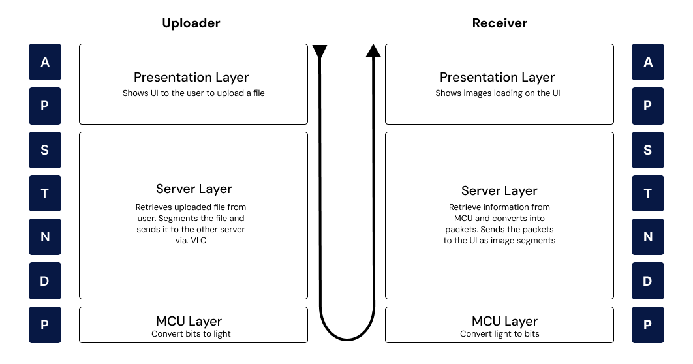

#  Reliable Data Transmission through a VLC System - Bachelor Thesis

|          |                                    |
|--------------------|-----------------------------------------------|
| **Author**         | Daniel Cargar Mahyar (s224797)               |
| **Field of study** | Softwaretechnology BS.c                      |
| **University**     | Technical University of Denmark (DTU)        |
| **Project Period** | 03/02/2025 - 19/05/2025 (15 week period)     |
| **Amount of ECTS** | 20                                           |
| **Department**     | [DTU Compute](https://www.compute.dtu.dk/)   |

## [1] Thesis Description
> 	This bachelor thesis focuses on the design, implementation, and evaluation of a short-range Visible Light Communication (VLC) system using LEDs and photodiodes. Custom circuitry will be developed for both the transmitter and receiver modules to enable data transmission through visible light. The primary objective is to achieve reliable data communication by designing a communication protocol tailored to the VLC system. This thesis will assess how efficiently a custom-built VLC system can transmit data over short distances and identify the key factors influencing its performance in terms of data rate, range, and signal integrity. Additionally, the thesis will demonstrate a practical application using the existing setup to showcase the concepts real-world use-cases.

## [2] Project Overview
The overall goal of the Bachelor Thesis is to facilitate data transmission through visible light communication. Specifically, the use case that is being built around is **transferring an image from one node to another**. 

Here is an overview of the general solution architecture:

<b>Figure 1</b>: Overview of system architecture

The use case starts by uploading a file to via. the Presentation Layer on the uploader/emitter node. The information is then sent to the server layer, where it will be split up into smaller pieces of data while also being run through algorithms like bitstuffing and putting flags inbetween all packages. Lastly, the packets of data are sent to the MCU layer, where they are emitted and received through visible light. The downloader/receiver then propagates all the received information up through the network stack to then show the picture on the presentation layer

This project contains all the code needed for this use case to work. A video demonstration is also available on this [YouTube link here](https://www.youtube.com/watch?v=v6vbDKfwIws)

## [3] Repository Structure
The project structure has been split up in two major parts:

1) Code for the MCU receiver and emitter using ESP-IDF
2) Code for the servers and presentation layer that presents the UI and sends/retrieves the data to the MCU using established webtechnologies like ExpressJS and NodeJS

### [3.1] MCU code - ESP-IDF
This is the part of the code that facilitates the actual transmission of raw bits and bytes. As described in the report, there are two different approaches to the project; Synchronous and Asynchronous 
#### [3.1.1] Method 1 - Synchronous Approach

The code for the synchronous approach can be found in [/src/method_1](./src/method_1/). For more details of the method implementation using ESP-IDF and FreeRTOS view the [Emitters README.MD file](./src/method_1/mcu_emitter/README.md) and the [Receiver README.MD file](./src/method_1/mcu_receiver/README.md)

#### [3.1.2] Method 2 - Asynchronous Approach using Oversampling
The code for the asynchronous approach can be found in [/src/method_2](./src/method_2/). For more details of the method implementation using ESP-IDF and FreeRTOS view the [Emitters README.MD file](./src/method_2/mcu_emitter/README.md) and the [Receiver README.MD file](./src/method_2/mcu_receiver/README.md)

### [3.2] Application Layer - HTML/CSS/JS & NodeJS
This is the part of the code that contains the server- and presentation layer. The server layers responsibility is to segment and repackage the data that was originally sent, in this case our file. 

All the code for the server- and presentation layer is contained in a mono-repo in the folder [/src/app/](./src/app/README.md).

### [3.3] Hardware Design (Both electronics and 3D design)
All drawings, 3D designs and such used throughout the project period have been compiled into the [hard_design](./hardware_design/) folder

## [4] Declaration of Generative AI and AI-assisted technologies in the writing process
This thesis acknowledges the use of Generative AI tools as part of its writing process.
The use of these tools followed DTU’s ethical principles and Generative AI guidelines.
All code and text assisted by Generative AI tools have been thoroughly reviewed and
validated by the authors for accuracy, appropriateness, and compliance with academic
integrity requirements. This serves as a disclosure of their use.

## [5] Credits
Thanks to Shield7 for uploading the Lamp Design on Thingverse under the [Attribution-NonCommercial-ShareAlike license](https://creativecommons.org/licenses/by-nc-sa/4.0/). The design was used as is with no additional changes

## [5] License and Use
Reproduction of this publication in whole or in part must include the custom
ary bibliographic citation, including author attribution, thesis title, etc.

